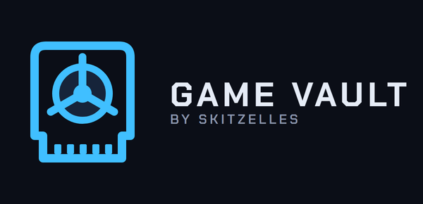

  

<h3 align="center">X1 BOX for Game Vault</h3>

  <b>Original Xbox games on Android, nothing to set up.</b> 
  The X1 BOX emulator (xemu for Android), built for <a href="https://github.com/skitzellez/game-vault-android">Game Vault for Android</a>:
  tap an Xbox game in Game Vault and it plays.

<!-- gv-buttons:start -->

  
  &nbsp;
  
  &nbsp;
  
  &nbsp;
  

<!-- gv-buttons:end -->

  
  
  
  
  

<table align="center">
  <tr>
    <td align="center" width="33%"><h3>📱 1. Put games on</h3>Your Xbox game files (.iso / .xiso) anywhere on the phone, SD card or USB drive.</td>
    <td align="center" width="33%"><h3>🎯 2. Pick</h3>Game Vault finds them, with names and box art.</td>
    <td align="center" width="33%"><h3>▶️ 3. Play</h3>Tap Play. No BIOS, no hard disk file, no folder to pick.</td>
  </tr>
</table>

---

> [!WARNING]
> **Beta.** Xbox emulation is heavy: a fast phone with **8 GB of RAM or more** and **Vulkan** is recommended.

> [!IMPORTANT]
> **No games and no Microsoft files are included, and none ever will be.** Use dumps of games you own.

## ✨ What is different from X1 BOX

- **No setup:** the free, open-source **[SpiritBoot](https://github.com/Mainkill1/SpiritBoot)** BIOS (GPL-2.0) and a
  blank Xbox hard disk are built in, so the setup wizard is skipped. Your own Xbox BIOS and boot ROM still win when
  you add them in Settings (needed for online play).
- **Takes the game straight from Game Vault:** no games folder to pick for games started from Game Vault.
- **Installs next to the original X1 BOX** (its own app id), so both can be kept.

Everything else is X1 BOX as its author made it.

## 🚀 Installation

The easy way: in **Game Vault for Android**, tap an Xbox game, then **Install**. That is all.

By hand: download **`X1BOX-GameVault_x.y.z.apk`** from the
**[latest release](https://github.com/skitzellez/x1box-gamevault/releases/latest)** and open it on the phone.

## 🔄 Updating

Game Vault shows a notice when a new version is out; tap it to install.

<!-- gv-family:start -->
## 🎮 The Game Vault family

Game Vault is one launcher plus emulators built to work with it. **Install [Game Vault](https://github.com/skitzellez/xbox-game-vault) and it sets these up for you**; press **RT** in Game Vault to update them all.

**Apps**

| Project | What it is | Runs on |
|---|---|---|
| [Game Vault](https://github.com/skitzellez/xbox-game-vault) | The launcher: plug in a USB drive, pick a game, play. Sets up everything below by itself. | Xbox Series X&#124;S |
| [Game Vault for Android](https://github.com/skitzellez/game-vault-android) | The same game library for phones, tablets and Android TV (beta). | Android |
| [Game Vault for iPhone](https://github.com/skitzellez/game-vault-ios) | The Game Vault look on iPhone (early test). | iPhone |

**Emulators built for Game Vault**

| Project | What it is | Runs on |
|---|---|---|
| [xemu for Xbox Dev Mode](https://github.com/skitzellez/xemu-uwp) | Original Xbox | Xbox Series X&#124;S |
| [Xenia for Game Vault](https://github.com/skitzellez/Xenia-GameVault) | Xbox 360 | Xbox Series X&#124;S |
| [XBSX2 for Game Vault](https://github.com/skitzellez/XBSX2-GameVault) | PlayStation 2 | Xbox Series X&#124;S |
| [Dolphin for Game Vault](https://github.com/skitzellez/Dolphin-GameVault) | GameCube and Wii | Xbox Series X&#124;S |
| [Game Vault · Wii U (Cemu)](https://github.com/skitzellez/Cemu-GameVault) | Wii U | Xbox Series X&#124;S |
| [RetroArch for Game Vault](https://github.com/skitzellez/RetroArch-GameVault) | PlayStation, Dreamcast, arcade and classic systems | Xbox Series X&#124;S, Android |
| [Game Vault · Flash](https://github.com/skitzellez/Flash-GameVault) | Flash games | Xbox Series X&#124;S |
| [Game Vault · OpenBOR](https://github.com/skitzellez/OpenBOR-GameVault) | OpenBOR beat 'em up games | Xbox Series X&#124;S |
| [Gambatte for Game Vault](https://github.com/skitzellez/Gambatte-GameVault) | Game Boy link cable in online rooms | Xbox Series X&#124;S, Android |
| [**X1 BOX for Game Vault**](https://github.com/skitzellez/x1box-gamevault) 📍 *you are here* | Original Xbox | Android |

**Extras**

| Project | What it is | Runs on |
|---|---|---|
| [Free games](https://github.com/skitzellez/game-vault-free-games) | Freeware and shareware for the FREE GAMES tab | Game Vault |
| [Fallout 1in2 for Xbox](https://github.com/skitzellez/Fallout1in2-Xbox) | The original Fallout, made for the controller | Xbox Series X&#124;S |
| [Game Vault updates](https://github.com/skitzellez/game-vault-updates) | Update data Game Vault reads when it starts | Game Vault |

**💬 Help, news and bug reports:** the [Game Vault Discord](https://discord.gg/RmhhWgguvw) (or this repo's Issues).
Please don't take problems with these builds to the original emulator teams: they don't make or support them.
<!-- gv-family:end -->

## 🙏 Credits

- **X1 BOX** by **[izzy2lost](https://github.com/izzy2lost/xemu)**, the Android port of xemu this build is made from.
- **[xemu](https://xemu.app)** and its contributors; QEMU.
- **[SpiritBoot](https://github.com/Mainkill1/SpiritBoot)** by Mainkill1 and contributors (GPL-2.0; unmodified v1.0.0
  files, see `android/app/src/main/assets/gamevault/`).
- Game Vault changes by **[Skitzelles](https://github.com/skitzellez)**, written with an AI assistant (Claude)
  working with the project owner.

The original X1 BOX readme is in [README-X1BOX.md](README-X1BOX.md).

## 📜 Licence

GPL-2.0, like xemu and QEMU (see [LICENSE](LICENSE) and [COPYING](COPYING)). The full source of every release is
this repository at the release's tag.
